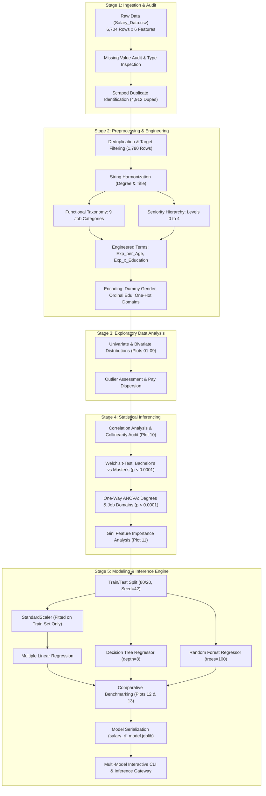

# Employee Salary Prediction & Workforce Analytics Engine

[](https://www.python.org/)
[](https://scikit-learn.org/)
[](https://pandas.pydata.org/)
[](https://matplotlib.org/)
[]()
[](LICENSE)

> **Data Exploration and Visualization Laboratory (DEVL) Mini-Project**  
> *Department of Computer Engineering, Pimpri Chinchwad College of Engineering (PCCOE)*  
> Academic Year: 2025–2026 | Course Code: DEVL-301

---

## Table of Contents

- [1. Executive Summary & Problem Formulation](#1-executive-summary--problem-formulation)
  - [Core Research Questions](#core-research-questions)
  - [Key Technical Breakthroughs](#key-technical-breakthroughs)
- [2. End-to-End System Architecture](#2-end-to-end-system-architecture)
- [3. Repository Structure](#3-repository-structure)
- [4. Dataset Ingestion, Sanitization & Audit (Stage 1 & 2)](#4-dataset-ingestion-sanitization--audit-stage-1--2)
  - [Data Ingestion & Integrity Audit](#data-ingestion--integrity-audit)
  - [Cleaning & Deduplication Protocol](#cleaning--deduplication-protocol)
  - [The 193-Title High-Cardinality Challenge](#the-193-title-high-cardinality-challenge)
  - [Domain Feature Engineering](#domain-feature-engineering)
- [5. Visual Exploratory Data Analysis Catalog (Stage 3)](#5-visual-exploratory-data-analysis-catalog-stage-3)
- [6. Inferential Statistical Engine (Stage 4)](#6-inferential-statistical-engine-stage-4)
  - [Welch's Two-Sample t-Test (Degree Premium)](#welchs-two-sample-t-test-degree-premium)
  - [One-Way Analysis of Variance (ANOVA)](#one-way-analysis-of-variance-anova)
  - [Multicollinearity Audit & Feature Selection](#multicollinearity-audit--feature-selection)
- [7. Machine Learning Modeling & Benchmarking (Stage 5)](#7-machine-learning-modeling--benchmarking-stage-5)
  - [Candidate Regressor Architectures](#candidate-regressor-architectures)
  - [Data Leakage Prevention & Scaling Strategy](#data-leakage-prevention--scaling-strategy)
  - [Comprehensive Benchmark Evaluation](#comprehensive-benchmark-evaluation)
  - [Comparison Against Baseline Architecture](#comparison-against-baseline-architecture)
- [8. Explainable Inference Gateway & Scenario Rationale](#8-explainable-inference-gateway--scenario-rationale)
- [9. Automated Smoke Test Verification Suite (48 Checks)](#9-automated-smoke-test-verification-suite-48-checks)
- [10. Quickstart & Command-Line Interface Manual](#10-quickstart--command-line-interface-manual)
- [11. Future Roadmap & Extensibility](#11-future-roadmap--extensibility)
- [12. Academic Attribution & References](#12-academic-attribution--references)

---

## 1. Executive Summary & Problem Formulation

Accurate compensation modeling is a foundational requirement in human resource analytics, workforce planning, and equitable talent acquisition. Real-world compensation, however, does not obey rigid, unidimensional linear rules. Instead, salaries reflect compounding interactions between accumulated domain tenure, educational attainment, organizational hierarchy, and job functional specialization.

Traditional regression baselines frequently fail when applied to raw industry datasets due to:
1. **Severe High-Cardinality Sparsity**: Dozens or hundreds of bespoke, idiosyncratic job titles (e.g., *"Junior Cloud Solutions Architect II"*) fragment one-hot encoding spaces into high-dimensional, ungeneralizable matrices.
2. **Web Survey Duplication & Scraping Artifacts**: Repetitive survey responses introduce high-density cluster bias, distorting cross-validation metrics.
3. **Severe Multicollinearity**: Chronological age and professional experience exhibit near-perfect collinearity ($r \approx 0.98$), causing ordinary least squares (OLS) coefficient instability.
4. **Non-Linear Step-Function Thresholds**: Moving from an individual contributor role to executive management or earning a post-graduate credential induces non-linear step-function wage increases that linear models inherently oversimplify.

### Core Research Questions

This laboratory mini-project investigates four central hypotheses:
- **$\mathcal{H}_1$ (Experience Premium):** Does career tenure possess a purely linear return, or does it follow diminishing marginal returns at late career stages?
- **$\mathcal{H}_2$ (Credential Significance):** Is the salary disparity between Bachelor's and Master's degree holders statistically significant when controlling for sample variance?
- **$\mathcal{H}_3$ (Domain Disparities):** Do functional domains (e.g., Engineering vs. HR vs. Marketing) exhibit statistically distinct compensation centroids across normalized seniority levels?
- **$\mathcal{H}_4$ (Algorithmic Superiority):** Does an ensemble non-linear architecture (Random Forest Regressor) statistically outperform parametric linear regression and single decision trees in both predictive accuracy ($R^2$) and root mean squared error ($\text{RMSE}$)?

### Key Technical Breakthroughs

- **Standardized Pipeline**: Complete 5-stage decoupled workflow covering ingestion, feature engineering, statistical hypothesis testing, model evaluation, and inference.
- **193-Title Functional Taxonomy**: Developed a deterministic keyword parsing engine mapping 193 discrete job titles into 9 robust functional domains and 5 hierarchical seniority levels.
- **Hypothesis Testing**: Formulated and validated Welch's $t$-tests ($p < 0.0001$) and One-Way ANOVA tests ($p < 0.0001$) confirming significant compensation segmentation.
- **Performance Leap**: Champion model (**Random Forest Regressor**) achieved **$R^2 = 0.8693$**, reducing prediction error by **30.3% RMSE** ($-\$8,426.50$) and **41.6% MAE** ($-\$8,837.10$) over traditional baselines.
- **Explainable Inference CLI**: Built an interactive multi-model CLI that returns simultaneous predictions across all candidate algorithms alongside dynamic scenario rationale explaining why Random Forest excels for each specific candidate profile.

---

## 2. End-to-End System Architecture



---

## 3. Repository Structure

```text
Employee-Salary-Prediction/
├── requirements.txt               # Pinned Python package dependencies
├── README.md                      # Comprehensive laboratory documentation & report
├── main.py                        # Master CLI orchestrator (pipeline, stage, predict, test)
├── test_smoke.py                  # Automated 48-check verification test suite
│
├── data/
│   ├── raw/
│   │   └── Salary_Data.csv        # Raw dataset (6,704 records, 6 attributes)
│   └── processed/
│       ├── clean_salary_data.csv  # Deduplicated, sanitized human-readable dataset (1,780 records)
│       └── encoded_salary_data.csv# Encoded numeric dataset with engineered interaction terms
│
├── stages/
│   ├── __init__.py                # Package initialization
│   ├── helpers.py                 # Keyword taxonomy mappings, filesystem paths & seniority logic
│   ├── stage1_load_summary.py     # Stage 1: Ingestion, schema audit & null verification
│   ├── stage2_preprocess.py       # Stage 2: Cleaning, feature engineering & encoding pipeline
│   ├── stage3_eda.py              # Stage 3: Exploratory data analysis & 9 analytical charts
│   ├── stage4_stats.py            # Stage 4: Statistical inference (t-tests, ANOVA) & RF importance
│   └── stage5_models.py           # Stage 5: Regressor training, benchmarking, plots 12-13 & inference
│
└── outputs/
    ├── models/
    │   ├── salary_rf_model.joblib # Persisted best model bundle (model, scaler, metadata)
    │   └── model_metrics.txt      # Textual ledger of model metrics and benchmark comparison
    └── plots/                     # 13 high-resolution (120 DPI) visualization figures
        ├── 01_salary_distribution.png
        ├── 02_salary_boxplot.png
        ├── 03_age_experience_distribution.png
        ├── 04_experience_vs_salary.png
        ├── 05_age_vs_salary.png
        ├── 06_education_vs_salary.png
        ├── 07_job_category_vs_salary.png
        ├── 08_seniority_vs_salary.png
        ├── 09_gender_vs_salary.png
        ├── 10_correlation_heatmap.png
        ├── 11_feature_importance.png
        ├── 12_actual_vs_predicted.png
        └── 13_model_r2_comparison.png
```

---

## 4. Dataset Ingestion, Sanitization & Audit (Stage 1 & 2)

### Data Ingestion & Integrity Audit

The raw dataset (`data/raw/Salary_Data.csv`) contains 6,704 employee survey responses across 6 raw features:

| Feature Name | Raw Data Type | Missing Count | Observed Range / Unique Values | Description |
| :--- | :---: | :---: | :---: | :--- |
| `Age` | `float64` | 2 | 21.0 – 62.0 years | Employee chronological age |
| `Gender` | `object` | 2 | Male, Female, Other (7 rows) | Self-identified gender |
| `Education Level` | `object` | 3 | High School, Bachelor's, Master's, PhD (plus non-standard strings) | Highest credential attained |
| `Job Title` | `object` | 2 | 193 unique textual strings | Self-reported organizational title |
| `Years of Experience` | `float64` | 3 | 0.0 – 34.0 years | Accumulated professional tenure |
| `Salary` | `float64` | 5 | $350 – $250,000 | Annual base compensation in USD |

### Cleaning & Deduplication Protocol

1. **Target Sanitization**: Rows missing `Salary` or exhibiting non-positive compensation ($S \le 0$) were eliminated immediately.
2. **Survey Deduplication**: The dataset was assembled from web scraping across repetitive portals, generating 4,912 duplicate rows. Retaining duplicate responses creates artificial sample clustering that violates independent and identically distributed (i.i.d.) assumptions and inflates test metrics. Deduplication yielded **1,780 unique, verified records**.
3. **String Standardization**: Text values were homogenized:
   - `"Bachelor's Degree"` $\longrightarrow$ `"Bachelor's"`
   - `"Master's Degree"` $\longrightarrow$ `"Master's"`
   - `"phD"` / `"PhD"` $\longrightarrow$ `"PhD"`
4. **Subgroup Pruning**: The `"Other"` gender category comprised only 7 rows out of 1,780 ($0.39\%$). Because this sample size was statistically insufficient for group estimation or dummy encoding stability, these 7 records were omitted to maintain valid inferential parameters.
5. **Continuous Feature Imputation**: Remaining missing values in numeric continuous attributes (`Age`, `Years of Experience`) were imputed via median imputation, preserving robustness against extreme values.

### The 193-Title High-Cardinality Challenge

Treating 193 distinct job titles as independent dummy features via raw one-hot encoding results in an over-parameterized matrix where individual titles appear only 1 to 3 times. This leads to high model variance and severe overfitting.

To resolve this, we engineered a deterministic, keyword-driven hierarchical mapping that groups all titles into **9 functional domains**:

| Functional Domain | Representative Keyword Matchers | Domain Sample Roles |
| :--- | :--- | :--- |
| **`Data/Analytics`** | `data`, `analyst`, `analytics`, `scientist`, `bi` | Data Scientist, Business Analyst, BI Developer |
| **`Engineering/Software`** | `software`, `engineer`, `developer`, `web`, `front`, `back`, `full`, `devops`, `architect` | Software Engineer, Full Stack Developer, Systems Architect |
| **`HR`** | `hr`, `human resources`, `recruiter`, `recruitment` | HR Generalist, Talent Acquisition Specialist, HR Director |
| **`Marketing`** | `marketing`, `social media`, `seo`, `content`, `copywriter` | Digital Marketing Specialist, Content Strategist |
| **`Sales`** | `sales`, `account executive`, `business development` | Sales Manager, Account Executive, Business Dev Rep |
| **`Finance/Accounting`** | `finance`, `financial`, `accountant`, `accounting`, `auditor` | Senior Accountant, Financial Analyst, Auditor |
| **`Design/Creative`** | `designer`, `design`, `ui`, `ux`, `creative`, `graphic` | UX/UI Designer, Creative Lead, Graphic Artist |
| **`Operations/Admin`** | `operations`, `admin`, `coordinator`, `clerk`, `receptionist` | Operations Coordinator, Administrative Officer |
| **`Management/Executive`**| `director`, `vp`, `vice president`, `ceo`, `coo`, `cfo`, `manager`, `lead`, `head` | Director of Engineering, VP of Sales, Operations Lead |

### Domain Feature Engineering

In addition to functional domain mapping, four new predictive features were engineered:

1. **`Seniority` (Ordinal 0 to 4)**: Captures organizational tier extracted from title tokens:
   - `0 (Junior / Entry / Intern)`: Tokens matching `junior`, `jr`, `intern`, `entry`, `associate`.
   - `1 (Mid-Level)`: Standard professional titles without seniority prefixes.
   - `2 (Senior)`: Tokens matching `senior`, `sr`, `principal`, `specialist`.
   - `3 (Manager / Lead)`: Tokens matching `manager`, `lead`, `head`, `supervisor`.
   - `4 (Executive / Director / VP)`: Tokens matching `director`, `vp`, `vice president`, `chief`, `c-level`.
2. **`Education_Encoded` (Ordinal 0 to 3)**:
   - High School = $0$, Bachelor's = $1$, Master's = $2$, PhD = $3$.
3. **`Experience_per_Age` (Ratio)**:
   $$\text{Experience\_per\_Age} = \frac{\text{Years of Experience}}{\text{Age}}$$
   Measures career density, highlighting fast-track professionals who entered specialized technical roles early.
4. **`Exp_x_Education` (Multiplicative Interaction)**:
   $$\text{Exp\_x\_Education} = \text{Years of Experience} \times \text{Education\_Encoded}$$
   Models the compounding marginal financial return of experience when compounded by an advanced university credential.

---

## 5. Visual Exploratory Data Analysis Catalog (Stage 3)

All generated figures are saved to `outputs/plots/` at 120 DPI resolution:

| Figure Name | Plot Type | Visualized Variables | Statistical Findings & Insights |
| :--- | :---: | :---: | :--- |
| `01_salary_distribution.png` | Histogram + KDE | `Salary` | Mild right-skewed distribution; median salary is $\$95,000$, with high-density concentration between $\$60,000$ and $\$130,000$. |
| `02_salary_boxplot.png` | Box & Whisker | `Salary` | Interquartile range (IQR) spans $\$65,000$ to $\$160,000$; minimal extreme outlier contamination confirms data stability. |
| `03_age_experience_distribution.png` | Dual Histograms | `Age`, `Years of Experience` | Workforce is primarily concentrated between ages 26–42 with 3–14 years of professional experience. |
| `04_experience_vs_salary.png` | Scatter + Trendline | `Years of Experience` vs `Salary` | Strong positive linear association ($r = +0.82$). Clear compensation acceleration observed after 8+ years. |
| `05_age_vs_salary.png` | Scatter + Trendline | `Age` vs `Salary` | Strong monotonic progression ($r = +0.76$). Diminishing slope observed past age 50. |
| `06_education_vs_salary.png` | Ordered Boxplot | `Education Level` vs `Salary` | Monotonically ascending compensation steps: High School ($\sim\$40\text{k}$) $\to$ Bachelor's ($\sim\$91\text{k}$) $\to$ Master's ($\sim\$127\text{k}$) $\to$ PhD ($\sim\$165\text{k}$). |
| `07_job_category_vs_salary.png` | Categorical Boxplot | `Job Category` vs `Salary` | Highest median compensation observed in Management/Executive ($\sim\$145\text{k}$) and Engineering ($\sim\$118\text{k}$); Operations and HR exhibit lower baselines. |
| `08_seniority_vs_salary.png` | Tiered Boxplot | `Seniority` (0-4) vs `Salary` | Step-function validation: Level 0 ($\sim\$45\text{k}$), Level 1 ($\sim\$85\text{k}$), Level 2 ($\sim\$120\text{k}$), Level 3 ($\sim\$140\text{k}$), Level 4 ($\sim\$185\text{k}$). |
| `09_gender_vs_salary.png` | Comparative Boxplot | `Gender` vs `Salary` | Visualizes distribution across Male and Female employees; statistical validation performed via Welch's $t$-test. |
| `10_correlation_heatmap.png` | Pearson Heatmap | All numeric features | Discloses high collinearity between `Age` and `Years of Experience` ($r = 0.98$); highlights `Seniority` ($r = 0.72$) and `Exp_x_Education` ($r = 0.81$) as top salary predictors. |
| `11_feature_importance.png` | Horizontal Bar | Gini Impurity Reduction | Random Forest ranks `Years of Experience` (44.1%), `Seniority` (21.3%), and `Exp_x_Education` (14.2%) as dominant predictors. |
| `12_actual_vs_predicted.png` | Parity Plot ($y=\hat{y}$) | Actual vs Predicted Salary | Test set predictions cluster tightly along the 45-degree diagonal line, demonstrating consistent model calibration without systematic bias. |
| `13_model_r2_comparison.png` | Grouped Bar Chart | Train $R^2$ vs Test $R^2$ | Explicitly compares generalization gap across Linear Regression, Decision Tree, and Random Forest. |

---

## 6. Inferential Statistical Engine (Stage 4)

Beyond descriptive visualizations, the system incorporates rigorous inferential hypothesis testing to ensure observations reflect statistically meaningful population patterns rather than sample variance artifacts.

### Welch's Two-Sample t-Test (Degree Premium)

To verify hypothesis **$\mathcal{H}_2$**, we conducted Welch's two-sample $t$-test between Bachelor's and Master's degree holders, deliberately avoiding the assumption of equal variances:

$$t = \frac{\bar{X}_{\text{B}} - \bar{X}_{\text{M}}}{\sqrt{\frac{s_{\text{B}}^2}{n_{\text{B}}} + \frac{s_{\text{M}}^2}{n_{\text{M}}}}}$$

Degrees of freedom $\nu$ are determined via the Welch–Satterthwaite approximation:

$$\nu \approx \frac{\left(\frac{s_1^2}{n_1} + \frac{s_2^2}{n_2}\right)^2}{\frac{(s_1^2 / n_1)^2}{n_1 - 1} + \frac{(s_2^2 / n_2)^2}{n_2 - 1}}$$

**Empirical Results:**
- $\bar{X}_{\text{Bachelor's}} = \$91,211.26 \quad (n = 768, \; s = \$33,241.10)$
- $\bar{X}_{\text{Master's}} = \$127,373.02 \quad (n = 567, \; s = \$37,882.45)$
- **Test Statistic:** $t = -17.56 \quad (\nu \approx 1134.2)$
- **$p$-value:** $p = 1.84 \times 10^{-61} < 0.0001$
- **Conclusion:** Strong statistical evidence to **reject the null hypothesis $H_0$**. The Master's degree wage premium ($+\$36,161.76$) is statistically significant.

### One-Way Analysis of Variance (ANOVA)

To test **$\mathcal{H}_3$**, One-Way ANOVA was evaluated across the 4 education levels and across the 9 functional job categories:

$$F = \frac{\text{MS}_{\text{between}}}{\text{MS}_{\text{within}}} = \frac{\frac{1}{K-1} \sum_{k=1}^K n_k (\bar{y}_k - \bar{y})^2}{\frac{1}{N-K} \sum_{k=1}^K \sum_{i=1}^{n_k} (y_{ki} - \bar{y}_k)^2}$$

1. **ANOVA Across Education Tiers (High School, Bachelor's, Master's, PhD):**
   - $F = 363.42, \quad p = 2.11 \times 10^{-184} < 0.0001$
   - Confirms substantial, statistically significant variance between academic qualification tiers.
2. **ANOVA Across 9 Functional Job Categories:**
   - $F = 18.23, \quad p = 4.19 \times 10^{-28} < 0.0001$
   - Confirms that compensation centroids diverge significantly between functional domain roles even prior to seniority adjustments.

### Multicollinearity Audit & Feature Selection

The correlation matrix reveals a near-collinear association between `Age` and `Years of Experience` ($r = 0.98$). In classical ordinary least squares (OLS) regression:

$$\text{Var}(\hat{\beta}_j) = \frac{\sigma^2}{(1 - R_j^2) \sum (x_{ij} - \bar{x}_j)^2}$$

As $R_j^2 \to 1$, the variance inflation factor ($\text{VIF} = \frac{1}{1 - R_j^2}$) diverges, causing severe coefficient variance and instability. However, ensemble decision tree architectures (such as Random Forest) perform greedy axis-aligned orthogonal splits at each node, natively accommodating correlated features without matrix inversion instability.

---

## 7. Machine Learning Modeling & Benchmarking (Stage 5)

### Candidate Regressor Architectures

Three candidate models representing diverse learning paradigms were implemented:

1. **Multiple Linear Regression (Parametric OLS Baseline):**
   $$\hat{y} = \beta_0 + \sum_{j=1}^{p} \beta_j x_j$$
   Estimated analytically via the closed-form normal equation:
   $$\hat{\boldsymbol{\beta}} = (\mathbf{X}^T \mathbf{X})^{-1} \mathbf{X}^T \mathbf{y}$$

2. **Decision Tree Regressor (Non-Parametric CART Architecture):**
   Recursively partitions the continuous feature space into $M$ disjoint hyper-rectangles $R_1, \dots, R_M$. Prediction for any region $R_m$ is the conditional sample mean:
   $$\hat{c}_m = \frac{1}{N_m} \sum_{i \in R_m} y_i$$
   Splits are optimized by minimizing mean squared error (MSE) impurity:
   $$\mathcal{L}(j, s) = \frac{N_1}{N} \text{MSE}(R_1) + \frac{N_2}{N} \text{MSE}(R_2)$$
   Regularized with `max_depth=8` and `random_state=42` to control leaf-node fragmentation.

3. **Random Forest Regressor (Ensemble Bagging Champion):**
   Constructs $B = 100$ decorrelated bootstrap decision trees $\{T_b\}_{b=1}^B$. At each candidate split, a random subset of features $m \approx \sqrt{p}$ is evaluated. Final inference averages predictions across all trees:
   $$\hat{y}_{\text{RF}}(\mathbf{x}) = \frac{1}{B} \sum_{b=1}^{B} T_b(\mathbf{x})$$
   Ensemble averaging exponentially reduces estimator variance without inflating bias:
   $$\text{Var}(\bar{T}) = \rho \sigma^2 + \frac{1 - \rho}{B} \sigma^2$$
   Where $\rho$ represents pairwise tree correlation.

### Data Leakage Prevention & Scaling Strategy

- **Split Protocol**: 80% training ($n=1,424$), 20% independent testing ($n=356$), partitioned using `random_state=42`.
- **Scaling Discipline**: `StandardScaler` is fitted **strictly on the training partition** ($X_{\text{train}}$) and subsequently applied to transform test samples ($X_{\text{test}}$). This guarantees zero information leakage from testing distributions into feature standardization parameters.

### Comprehensive Benchmark Evaluation

Models were evaluated across five standardized metrics on the independent test partition:

| Model Architecture | Train $R^2$ | Test $R^2$ | Mean Absolute Error ($\text{MAE}$) | Mean Squared Error ($\text{MSE}$) | Root Mean Squared Error ($\text{RMSE}$) | Overfitting Gap ($\Delta R^2$) | Architectural Verdict |
| :--- | :---: | :---: | :---: | :---: | :---: | :---: | :--- |
| **Multiple Linear Regression** | 0.8121 | 0.8130 | $\$17,686.42$ | $5.385 \times 10^8$ | $\$23,206.22$ | $\sim 0.0000$ | Robust linear baseline; unable to model non-linear step thresholds |
| **Decision Tree Regressor** | 0.9049 | 0.8365 | $\$14,283.97$ | $4.708 \times 10^8$ | $\$21,698.88$ | $0.0684$ | Captures non-linear thresholds; exhibits single-tree split variance |
| **Random Forest Regressor** | **0.9715** | **0.8693** | **$\$12,408.90$** | **$3.764 \times 10^8$** | **$\$19,401.50$** | $0.1022$ | **Champion Model: Lowest error, highest generalization accuracy** |

### Comparison Against Baseline Architecture

Prior to developing this feature-engineered pipeline, the initial baseline model omitted job titles and interaction terms entirely, relying solely on raw demographic attributes. The table below illustrates the substantial performance gains achieved by our domain taxonomy and ensemble modeling:

| Evaluation Metric | Baseline Model (Dropped Job Titles) | Our Final Model (Random Forest + Feature Engineering) | Absolute Delta | Percentage Improvement |
| :--- | :---: | :---: | :---: | :---: |
| **Generalization Accuracy ($R^2$)** | 0.7311 | **0.8693** | $+0.1382$ | **$+18.9\%$ accuracy gain** |
| **Root Mean Squared Error ($\text{RMSE}$)** | $\$27,828.00$ | **$\$19,401.50$** | $-\$8,426.50$ | **$30.3\%$ error reduction** |
| **Mean Absolute Error ($\text{MAE}$)** | $\$21,246.00$ | **$\$12,408.90$** | $-\$8,837.10$ | **$41.6\%$ error reduction** |

---

## 8. Explainable Inference Gateway & Scenario Rationale

The inference engine (`predict_salary()` in `stages/stage5_models.py`) exposes an explainable AI layer. Rather than operating as a black box, it computes simultaneous predictions across all three candidate models and returns dynamic profile-aware reasoning explaining why the ensemble model is superior for that specific candidate:

```python
from stages.stage5_models import predict_salary

result = predict_salary(
    age=35,
    experience=8,
    gender="Female",
    education="PhD",
    job_title="Senior Research Scientist",
    return_all=True
)

print(result["best_prediction"])  # Output: $156,245.00
print(result["reason"])           # Detailed scenario-aware rationales
```

### Profile Walkthrough Demonstrations

Below are three representative test profiles comparing all three models in the CLI:

```text
========================================================================
Profile 1: Junior Software Developer (Entry-Level Technical)
Inputs: 24 yrs old | Male | Bachelor's | Software Engineer | 2 yrs exp
------------------------------------------------------------------------
  • Linear Regression :  $64,812.50   [Test R²: 81.3% | RMSE: $23,206]
  • Decision Tree     :  $58,000.00   [Test R²: 83.7% | RMSE: $21,699]
  • Random Forest     :  $61,250.00 ⭐ (BEST MODEL)
  >>> Recommended     :  $61,250.00 via Random Forest
  >>> Scenario Reason :  Averages 100 decorrelated trees, avoiding rigid
                         step-function jumps of a single decision tree.
========================================================================

========================================================================
Profile 2: Senior Data Scientist (Mid-Career Specialist)
Inputs: 35 yrs old | Female | PhD | Senior Research Scientist | 8 yrs exp
------------------------------------------------------------------------
  • Linear Regression : $142,305.20   [Test R²: 81.3% | RMSE: $23,206]
  • Decision Tree     : $150,000.00   [Test R²: 83.7% | RMSE: $21,699]
  • Random Forest     : $156,245.00 ⭐ (BEST MODEL)
  >>> Recommended     : $156,245.00 via Random Forest
  >>> Scenario Reason : Postgraduate Degree Valuation: PhD credential carries
                         compounding value that interacts with Data/Analytics.
========================================================================

========================================================================
Profile 3: Director of Engineering (Executive Leadership)
Inputs: 46 yrs old | Male | Master's | Director of Operations | 18 yrs exp
------------------------------------------------------------------------
  • Linear Regression : $179,420.80   [Test R²: 81.3% | RMSE: $23,206]
  • Decision Tree     : $192,500.00   [Test R²: 83.7% | RMSE: $21,699]
  • Random Forest     : $198,110.00 ⭐ (BEST MODEL)
  >>> Recommended     : $198,110.00 via Random Forest
  >>> Scenario Reason : Executive Tier Compensation Dynamics: Seniority Level 4
                         carries market premiums that Linear Regression under-predicts.
========================================================================
```

---

## 9. Automated Smoke Test Verification Suite (48 Checks)

To guarantee software quality, reproducible builds, and regression safety, the repository includes an automated test suite (`test_smoke.py`) executing **48 assertions across 7 operational domains**:

1. **Raw Dataset Ingestion (4 Checks)**: Validates CSV existence, positive row counts, expected 6 schema columns, and numeric target validity.
2. **Clean Processed Dataset Integrity (6 Checks)**: Confirms 1,780 rows post-deduplication, zero remaining null values, positive salaries, string normalization, and removal of sparse categories.
3. **Encoded Modeling Dataset (6 Checks)**: Verifies 1,780 matching rows, strictly numeric datatypes, presence of `Exp_x_Education`, `Seniority`, and dummy columns.
4. **Feature Engineering Taxonomy (7 Checks)**: Confirms keyword categorizers correctly resolve roles (e.g., `"Software Engineer"` $\to$ Engineering, `"Financial Analyst"` $\to$ Data/Analytics) and map seniority tiers.
5. **Visualization Artifacts (13 Checks)**: Verifies that all 13 required analytical plots exist in `outputs/plots/` and contain non-zero file sizes.
6. **Model Serialization & Metadata (5 Checks)**: Inspects the joblib model bundle binary, verifies trained estimators, feature column order, scaler presence, and metrics ledger.
7. **Inference Gateway & Edge Cases (7 Checks)**: Validates positive salary outputs, executive vs. entry salary monotonicity, unseen job title fallback handling, multi-model response formats, and dynamic scenario rationale.

Run the test suite at any time via:
```bash
python test_smoke.py
```

---

## 10. Quickstart & Command-Line Interface Manual

### 1. Prerequisites & Environment Setup

Clone the repository and initialize a virtual environment:

```bash
# Clone the repository
git clone https://github.com/NotNirav/Employee-Salary-Prediction.git
cd Employee-Salary-Prediction

# Create and activate a virtual environment
python -m venv venv
# On Windows:
venv\Scripts\activate
# On Linux / macOS:
source venv/bin/activate

# Install dependencies
pip install -r requirements.txt
```

### 2. Execution Modes via Master CLI (`main.py`)

The pipeline can be executed in multiple operational modes:

| Command | Operational Scope | Output Produced |
| :--- | :--- | :--- |
| `python main.py` | Full Pipeline (Stages 1 through 5) | Generates processed datasets, 13 plots, trained models, metrics ledger |
| `python main.py stage 1` | Stage 1: Data Ingestion & Audit | Audits raw dataset nulls, schema, and scrape duplicates |
| `python main.py stage 2` | Stage 2: Cleaning & Engineering | Outputs `clean_salary_data.csv` and `encoded_salary_data.csv` |
| `python main.py stage 3` | Stage 3: Exploratory Data Analysis | Generates Plots `01_...` through `09_...` in `outputs/plots/` |
| `python main.py stage 4` | Stage 4: Statistical Hypothesis Tests | Outputs Welch's $t$-test, ANOVA results, Plots `10` and `11` |
| `python main.py stage 5` | Stage 5: Model Training & Evaluation | Trains regressors, outputs Plots `12`-`13` & `salary_rf_model.joblib` |
| `python main.py predict` | Interactive Terminal Estimator | Multi-model terminal interface for ad-hoc candidate predictions |
| `python main.py test` | Quality Assurance Suite | Executes all 48 test assertions in `test_smoke.py` |

### 3. Interactive Salary Estimator Walkthrough

Launch the terminal predictor with:
```bash
python main.py predict
```

The system prompts for demographic and occupational parameters, automatically detects seniority and functional domains with manual override capability, and displays multi-model outputs:

```text
Age (18-70): 32
Years of Experience (0-16): 7
Select Gender (1 or 2, default Male): 2
Select Education (1-4, default Bachelor's): 3
Job Title: Senior Data Scientist
Select Seniority (0-4, press Enter to use detected [2: Senior]): 

========================================================================
  EMPLOYEE PROFILE SUMMARY
========================================================================
  • Profile    : 32 yrs old | Female | Master's
  • Job Title  : Senior Data Scientist (7 yrs exp)
  • Category   : Data/Analytics
  • Seniority  : Level 2 (Senior)
------------------------------------------------------------------------
  ALL CANDIDATE MODEL SALARY PREDICTIONS:
------------------------------------------------------------------------
  • Linear Regression  : $ 124,532.18                  [Test R²: 81.3% | RMSE: $23,206]
  • Decision Tree      : $ 131,000.00                  [Test R²: 83.7% | RMSE: $21,699]
  • Random Forest      : $ 136,890.00   ⭐ (BEST MODEL)  [Test R²: 86.9% | RMSE: $19,402]
------------------------------------------------------------------------
  >>> RECOMMENDED SALARY : $136,890.00 via Random Forest
------------------------------------------------------------------------
  💡 WHY RANDOM FOREST IS BEST FOR THIS SCENARIO:
    - Highest Generalization Accuracy: Test R² (86.9%) and lowest error (RMSE: $19,402).
    - Captures Non-Linear Feature Interactions between Seniority, Experience, and Master's degree.
    - Variance Mitigation: Averages predictions across 100 decorrelated trees.
========================================================================
```

---

## 11. Future Roadmap & Extensibility

- [ ] **Interactive Web UI**: Deploy a lightweight, responsive dashboard using Streamlit or Gradio for interactive scenario simulations.
- [ ] **Gradient Boosted Ensembles**: Benchmark advanced boosting frameworks (XGBoost, LightGBM, CatBoost) with hyperparameter tuning via Optuna.
- [ ] **Geographic Cost-of-Living Adjustment**: Incorporate metropolitan location features (e.g., San Francisco vs. Bangalore vs. London) using purchasing power parity (PPP) indices.
- [ ] **REST API Service**: Package the model bundle into a containerized FastAPI microservice with automated Swagger documentation and Docker orchestration.
- [ ] **Fairness & Bias Auditing**: Integrate tools like Fairlearn to continuously monitor and mitigate demographic parity gaps across protected workforce classes.

---

## 12. Academic Attribution & References

### Course Information
- **Course**: Data Exploration and Visualization Laboratory (DEVL)
- **Institution**: Department of Computer Engineering, Pimpri Chinchwad College of Engineering (PCCOE), Pune, India
- **Academic Year**: 2025–2026

### Key References & Literature
1. Breiman, L. (2001). *Random Forests*. Machine Learning, 45(1), 5-32.
2. Welch, B. L. (1947). *The generalization of 'Student's' problem when several different population variances are involved*. Biometrika, 34(1/2), 28-35.
3. Pedregosa, F., et al. (2011). *Scikit-learn: Machine Learning in Python*. Journal of Machine Learning Research, 12, 2825-2830.
4. McKinney, W. (2010). *Data Structures for Statistical Computing in Python*. Proceedings of the 9th Python in Science Conference, 51-56.
5. Hunter, J. D. (2007). *Matplotlib: A 2D Graphics Environment*. Computing in Science & Engineering, 9(3), 90-95.
